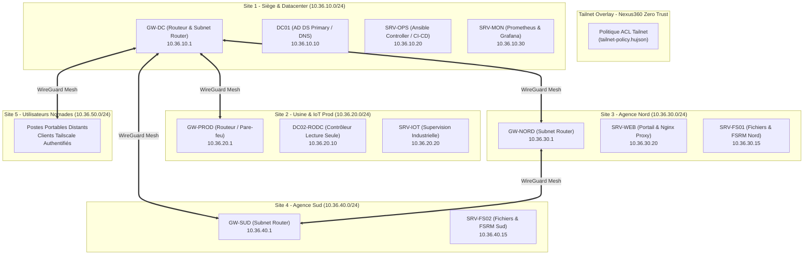
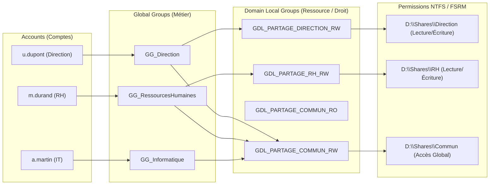

# Dossier d'Architecture Technique (DAT) - Projet Nexus360 (T01)

| Métadonnée | Valeur |
| :--- | :--- |
| **Projet** | Nexus360 - Infrastructure d'Entreprise Multi-Sites |
| **Équipe projet** | Équipe T01 (Promotion B3) |
| **Version du document** | v1.0.0 |
| **Statut** | Validé / En cours de déploiement |
| **Date de référence** | Octobre 2026 |
| **Supernet Dédié** | `10.36.0.0/16` |

---

## 1. Contexte & Enjeux Métier

L'organisation **Nexus360** opère sur un modèle multi-sites constitué d'un siège administratif et technique principal (Datacenter), d'une usine de fabrication connectée, de deux agences régionales autonomes et d'une force commerciale nomade.

### 1.1 Objectifs Stratégiques
1. **Haute Résilience & Continuité d'Activité (PCA/PRA)** : Assurer la disponibilité des services critiques (Active Directory, DNS, messagerie/collaboratif, bases de données) même en cas d'isolement d'un site.
2. **Cloisonnement & Sécurité Zero Trust** : Éliminer les accès réseau implicites en s'appuyant sur un réseau overlay chiffré (Tailscale WireGuard) régulé par des ACL strictes.
3. **Gouvernance Centralisée des Identités** : Appliquer le modèle **AGDLP** (Accounts -> Global Groups -> Domain Local Groups -> Permissions) garantissant la traçabilité et l'auditabilité des accès.
4. **Standardisation & Automatisation (IaC)** : Déployer et maintenir les serveurs via Ansible afin d'éliminer toute dérive de configuration (*Configuration Drift*).
5. **Observabilité Proactive** : Collecter les métriques système et surveiller les SLA par le biais d'un pôle de supervision centralisé (Prometheus/Grafana).

---

## 2. Schéma Réseau & Architecture Globale

L'infrastructure physique et virtuelle est interconnectée via un maillage chiffré Tailscale garantissant une communication point-à-point (P2P) à faible latence avec bascule dynamique en relais DERP si nécessaire.

---

## 3. Plan d'Adressage Hiérarchique (Supernet `10.36.0.0/16`)

Le supernet d'entreprise `10.36.0.0/16` est subdivisé en sous-réseaux `/24` dédiés par site et par usage.

| Sous-Réseau CIDR | Site / Périmètre | Passerelle par défaut | Usage & Affectation |
| :--- | :--- | :--- | :--- |
| **`10.36.10.0/24`** | **Site 1 : Datacenter / Siège** | `10.36.10.1` | Contrôleur principal AD DS, supervision, contrôleur Ansible |
| **`10.36.11.0/24`** | Site 1 : Postes Siège | `10.36.11.1` | Postes de travail administratifs et direction |
| **`10.36.20.0/24`** | **Site 2 : Usine / Production** | `10.36.20.1` | Contrôleur RODC, serveurs IoT et passerelles industrielles |
| **`10.36.21.0/24`** | Site 2 : Terminaux Ateliers | `10.36.21.1` | Écrans tactiles, automates et scanners d'atelier |
| **`10.36.30.0/24`** | **Site 3 : Agence Nord** | `10.36.30.1` | Serveur Web applicatif, serveur de fichiers Nord |
| **`10.36.31.0/24`** | Site 3 : Postes Agence Nord | `10.36.31.1` | Postes de travail collaborateurs région Nord |
| **`10.36.40.0/24`** | **Site 4 : Agence Sud** | `10.36.40.1` | Serveur de fichiers Sud, réplication locale |
| **`10.36.41.0/24`** | Site 4 : Postes Agence Sud | `10.36.41.1` | Postes de travail collaborateurs région Sud |
| **`10.36.50.0/24`** | **Site 5 : Nomades & VDI** | `10.36.50.1` | Passerelle VPN d'accès distant & pool VDI |
| **`10.36.99.0/24`** | Interconnexions & DMZ | `10.36.99.1` | Services exposés publiquement sous haute surveillance |

---

## 4. Inventaire des Machines Virtuelles & Rôles

| Hostname | Rôle Technique | Système d'Exploitation | IP Fixe | vCPU | RAM | Stockage | Site |
| :--- | :--- | :--- | :--- | :---: | :---: | :---: | :--- |
| **`NX-GW-DC01`** | Passerelle & Routeur Tailscale | Debian 12 Minimal | `10.36.10.1` | 2 | 2 Go | 30 Go | Site 1 |
| **`NX-AD-DC01`** | Primary DC (AD DS, DNS, NTP) | Windows Server 2022 | `10.36.10.10` | 4 | 8 Go | 80 Go | Site 1 |
| **`NX-OPS-SRV01`** | Ansible Controller & GitOps | Ubuntu 22.04 LTS | `10.36.10.20` | 2 | 4 Go | 60 Go | Site 1 |
| **`NX-MON-SRV01`** | Monitoring (Prometheus/Grafana) | Debian 12 Minimal | `10.36.10.30` | 2 | 4 Go | 80 Go | Site 1 |
| **`NX-GW-PROD01`**| Passerelle Usine / Pare-feu | Rocky Linux 9 | `10.36.20.1` | 2 | 2 Go | 30 Go | Site 2 |
| **`NX-AD-RODC01`**| Read-Only Domain Controller | Windows Server 2022 | `10.36.20.10` | 2 | 4 Go | 60 Go | Site 2 |
| **`NX-IOT-SRV01`**| Collecteur IoT & Métriques Prod | Debian 12 Minimal | `10.36.20.20` | 2 | 4 Go | 50 Go | Site 2 |
| **`NX-GW-NORD01`**| Passerelle Agence Nord | Debian 12 Minimal | `10.36.30.1` | 2 | 2 Go | 30 Go | Site 3 |
| **`NX-FS-NORD01`**| Serveur de fichiers & FSRM Nord | Windows Server 2022 | `10.36.30.15` | 2 | 6 Go | 150 Go | Site 3 |
| **`NX-WEB-SRV01`**| Nginx Reverse Proxy / Web App | Debian 12 Minimal | `10.36.30.20` | 2 | 4 Go | 40 Go | Site 3 |
| **`NX-GW-SUD01`** | Passerelle Agence Sud | Debian 12 Minimal | `10.36.40.1` | 2 | 2 Go | 30 Go | Site 4 |
| **`NX-FS-SUD01`** | Serveur de fichiers & FSRM Sud | Windows Server 2022 | `10.36.40.15` | 2 | 6 Go | 150 Go | Site 4 |

---

## 5. Matrice des Flux Réseau

La sécurité réseau applique le principe du moindre privilège (*Default Deny*).

| Source | Destination | Protocole | Port(s) | Description / Rationale |
| :--- | :--- | :---: | :---: | :--- |
| **Tous les sous-réseaux** | `10.36.10.10` (DC01) | UDP / TCP | 53 | Résolution DNS d'entreprise |
| **Tous les sous-réseaux** | `10.36.10.10` (DC01) | UDP | 123 | Synchronisation d'horloge NTP |
| **Clients & Serveurs Windows**| `10.36.10.10` (DC01) | TCP / UDP | 88, 135, 389, 445, 464, 636, 3268 | Trafic Active Directory, Kerberos, LDAP, RPC |
| **`NX-OPS-SRV01` (Ansible)** | **Tous les serveurs Linux** | TCP | 22 | Administration SSH automatisée par clé |
| **`NX-OPS-SRV01` (Ansible)** | **Serveurs Windows** | TCP | 5985, 5986 | Administration WinRM / PowerShell Remoting |
| **`NX-MON-SRV01` (Prometheus)**| **Tous les nœuds** | TCP | 9100, 9182 | Scrape Node Exporter & Windows Exporter |
| **Admin IT Nomades / Postes** | `10.36.10.30` (Grafana) | TCP | 3000 | Consultation des tableaux de bord de supervision |
| **Utilisateurs Agences** | `NX-FS-NORD01` / `SUD01` | TCP | 445 | Accès aux partages SMB d'entreprise |
| **Postes Internes** | `10.36.30.20` (WEB) | TCP | 80, 443 | Accès au portail applicatif Nexus360 |
| **Toutes Passerelles** | Tailscale Coordination Server | UDP | 41641 / WireGuard | Négociation tunnel maillé P2P chiffré |

---

## 6. Matrice des Droits & Modèle AGDLP

Le principe **AGDLP** structure la gestion des autorisations :
1. **A**ccounts (Utilisateurs dans leur OU respective)
2. **G**lobal Groups (Groupes basés sur le métier : `GG_<DEPARTEMENT>`)
3. **D**omain **L**ocal Groups (Groupes basés sur la ressource et l'action : `GDL_<RESSOURCE>_<DROIT>`)
4. **P**ermissions (Affectation sur le système de fichiers NTFS ou le partage)

### Table de Correspondance AGDLP & Quotas FSRM

| Dossier Partagé | Groupe Global (GG) | Groupe Domaine Local (GDL) | Droit NTFS | Quota FSRM | Type de Quota |
| :--- | :--- | :--- | :---: | :---: | :---: |
| `D:\Shares\Direction` | `GG_Direction` | `GDL_DIRECTION_RW` | Modify (Lecture/Écriture) | 100 Go | Hard (Bloquant) |
| `D:\Shares\RH` | `GG_RessourcesHumaines` | `GDL_RH_RW` | Modify | 50 Go | Hard (Bloquant) |
| `D:\Shares\Finance` | `GG_Finance` | `GDL_FINANCE_RW` | Modify | 80 Go | Hard (Bloquant) |
| `D:\Shares\Informatique`| `GG_Informatique` | `GDL_INFORMATIQUE_FULL` | Full Control | 200 Go | Soft (Alerte à 85%) |
| `D:\Shares\Ventes` | `GG_Ventes` | `GDL_VENTES_RW` | Modify | 120 Go | Hard (Bloquant) |
| `D:\Shares\Commun` | *Tous les GG métiers* | `GDL_COMMUN_RW` | Read/Write (Pas de suppression racine) | 300 Go | Hard (Bloquant) |

---

## 7. Plan de Sauvegarde & Résilience

- **Active Directory** : Sauvegarde d'état du système (*System State Backup*) quotidienne via Windows Server Backup + réplication multi-sites (DC01 / RODC02).
- **Volumes Fichiers (FSRM)** : Snapshots VSS (Clichés instantanés) à 08h00 et 13h00 quotidiennement ; réplication chiffrée vers Site 4 de secours.
- **Configurations Ansible & Scripts** : Versionnés sur GitHub, idempotents et redéployables en moins de 30 minutes sur serveur vierge.
