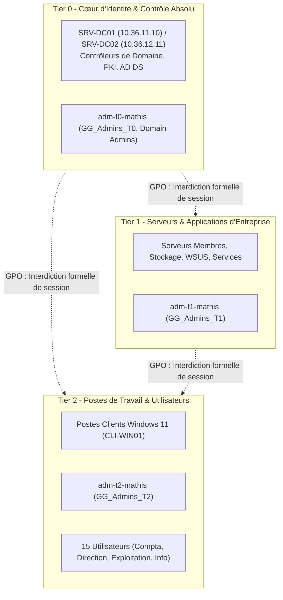

# Nexus360 - Infrastructure & Automatisation Multi-Sites (Promotion B3 - Équipe T01)

[](docs/DAT_Site1.md)
[](scripts/windows/)
[](scripts/windows/)
[](docs/runbooks/Runbook_Rebuild_LNXGW01.md)
[](reseau/tailnet-policy.hujson)

---

## 1. Présentation de la Mission T01 - Site 1 (Paris)

Dans le cadre du projet **Nexus360**, la mission **T01** a pour objectif de concevoir, déployer, sécuriser et automatiser le socle d'infrastructure du **Site 1 (Paris)**, siège central et cœur d'identité de l'entreprise.

### Architecture Clé du Site 1 :
- **Domaine Active Directory** : `ad.nexus360.test`
- **Passerelle de routage & sécurité (`LNXGW01`)** : Rocky Linux 10 (`10.36.11.1` / VIP Tailscale `10.36.10.1`), routage IPv4 kernel, NAT Masquerading via `firewalld`, et Subnet Router Tailscale annonçant `10.36.11.0/24`.
- **Contrôleur de domaine principal (`SRV-DC01`)** : Windows Server 2025 (`10.36.11.10`), rôles AD DS, DNS Server (zones directe et inverse `36.10.in-addr.arpa`), DHCP Server (scope `10.36.11.0/24`), et point de mise à jour WSUS (port 8530).
- **Client de recette (`CLI-WIN01`)** : Windows 11 Entreprise configuré en attribution DHCP dynamique (plage `10.36.11.100` à `10.36.11.200`), joint au domaine dans l'OU `Nexus360/Postes`.
- **Interconnexion Site 2** : Sous-réseau distant `10.36.12.0/24`, second DC `SRV-DC02` (`10.36.12.11`) avec préparation de la haute disponibilité DHCP Failover en LoadBalance 50/50.

---

## 2. Structure du Dépôt

Le dépôt est structuré de manière rigoureuse pour séparer configurations, scripts d'automatisation, politiques réseau et documentation d'exploitation :

```text
Projet_Nexus360_B3/
├── README.md                                  # Présentation globale, architecture et guide de déploiement
├── DAT.md                                     # DAT macro du projet multi-sites
├── JOURNAL.md                                 # Journal de bord général
│
├── config/                                    # Fichiers sources et données déclaratives du Site 1
│   ├── utilisateurs.csv                       # Annuaire des 15 utilisateurs répartis dans 4 services
│   └── ad_structure.json                      # Schéma JSON des OU, groupes AGDLP et comptes Tiering
│
├── scripts/windows/                           # Scripts PowerShell d'automatisation idempotents
│   ├── 01-Create-OU-and-AGDLP.ps1             # Création de l'arborescence OU et des groupes GG / DL
│   ├── 02-Import-Users.ps1                    # Import des 15 utilisateurs et provisionnement Tiering (T0/T1/T2)
│   ├── 03-Configure-DNS-and-GPO.ps1           # Zone inverse, alias CNAME, autoreprise services, GPO T0 & WSUS
│   └── 04-Setup-DHCP-Failover.ps1             # Scope DHCP Site 1 et partenariat Failover LoadBalance 50/50
│
├── docs/                                      # Documentation technique et opérationnelle
│   ├── DAT_Site1.md                           # Dossier d'Architecture Technique détaillé du Site 1 (Paris)
│   ├── JOURNAL_EXPLOITATION.md                # Journal chronologique détaillé des actions de séance
│   └── runbooks/                              # Runbooks d'exploitation pas à pas
│       ├── Runbook_Import_Users.md            # Procédure d'importation CSV et plan de Rollback
│       ├── Runbook_Rebuild_LNXGW01.md         # Reconstruction de la passerelle Rocky Linux (NAT/Tailscale)
│       ├── RUNBOOK_ACTIVE_DIRECTORY_AGDLP.md  # Standard AGDLP
│       ├── RUNBOOK_DEPLOIEMENT_ANSIBLE.md     # Déploiement Ansible
│       └── RUNBOOK_INTERCONNEXION_TAILNET.md  # Configuration du Tailnet
│
├── reseau/                                    # Fichiers de configuration réseau
│   └── tailnet-policy.hujson                  # Politique de sécurité et ACLs Tailscale
│
├── ansible/                                   # Automatisation des socles Linux multi-sites
│   ├── site.yml                               # Playbook maître
│   └── roles/                                 # Rôles base, web, ops, mon, gw
│
└── powershell/                                # Scripts legacy et modules complémentaires
```

---

## 3. Modèle de Sécurité : Tiering T0 / T1 / T2 & AGDLP

Nexus360 applique les meilleures pratiques de sécurité d'entreprise (recommandations ANSSI / Microsoft) :



- **GPO_Security_Block_T0_Logon** : Bloque l'ouverture de session locale et RDP des administrateurs Tier 0 (`GG_Admins_T0`) sur les postes Tier 2 et serveurs Tier 1 pour éviter la dispersion des identifiants maîtres dans la mémoire LSASS.
- **GPO_WSUS_Clients** : Configure l'adresse du serveur WSUS (`http://SRV-DC01.ad.nexus360.test:8530`) et les horaires de déploiement automatique des correctifs sur les postes clients.

---

## 4. Instructions Pas-à-Pas pour Déployer & Rejouer l'Automatisation

Tous les scripts situés dans `scripts/windows/` sont conçus pour être **strictement idempotents** : ils peuvent être rejoués à tout moment sans provoquer d'erreur ni dupliquer d'objets.

### Étape 4.1 : Déploiement de la Passerelle Linux `LNXGW01`
Consulter et exécuter le runbook dédié :
👉 [Runbook Reconstruction LNXGW01](docs/runbooks/Runbook_Rebuild_LNXGW01.md)

### Étape 4.2 : Initialisation de l'Arborescence OU et des Groupes AGDLP
Depuis une session PowerShell Administrateur sur `SRV-DC01` :
```powershell
# 1. Se positionner à la racine du dépôt
cd C:\Users\mathi\Desktop\Projet_Nexus360_B3

# 2. Exécuter le script de création de structure
& ".\scripts\windows\01-Create-OU-and-AGDLP.ps1"
```

### Étape 4.3 : Importation des 15 Utilisateurs et Comptes de Tiering
```powershell
# Exécuter le script de provisionnement des utilisateurs
& ".\scripts\windows\02-Import-Users.ps1"
```
*Note* : En cas de besoin de réinitialisation complète, suivre la procédure de rollback documentée dans [Runbook Import Users](docs/runbooks/Runbook_Import_Users.md).

### Étape 4.4 : Configuration DNS, Autoreprise des Services et GPOs
```powershell
# Déploiement de la zone inverse, de l'alias intranet, des sc.exe failure et des GPOs
& ".\scripts\windows\03-Configure-DNS-and-GPO.ps1"
```

### Étape 4.5 : Configuration du Serveur DHCP & Préparation Failover
```powershell
# Configuration de l'étendue DHCP Site 1 et préparation du lien avec SRV-DC02
& ".\scripts\windows\04-Setup-DHCP-Failover.ps1"
```

---

## 5. Recette & Validation des Services

| Test de Validation | Commande de Recette | Résultat Attendu |
| :--- | :--- | :--- |
| **Résolution DNS directe** | `Resolve-DnsName SRV-DC01.ad.nexus360.test` | Résout sur `10.36.11.10` |
| **Résolution DNS inverse** | `Resolve-DnsName 10.36.11.10` | Résout sur `SRV-DC01.ad.nexus360.test` |
| **Alias CNAME intranet** | `Resolve-DnsName intranet.ad.nexus360.test` | Pointe sur `lnx-web01.ad.nexus360.test` |
| **Vérification Utilisateurs** | `(Get-ADUser -SearchBase "OU=Utilisateurs,OU=Nexus360,DC=ad,DC=nexus360,DC=test" -Filter *).Count` | Exactement `15` |
| **Comptes de Tiering** | `Get-ADUser adm-t0-mathis`, `adm-t1-mathis`, `adm-t2-mathis` | Présents dans leurs OU respectives |
| **GPO appliquées** | `gpresult /r` (sur `CLI-WIN01`) | `GPO_Security_Block_T0_Logon` et `GPO_WSUS_Clients` |
| **Reprise de service** | `sc.exe qfailure DNS` | Actions `restart/60000/restart/60000/restart/60000` |
| **Bail DHCP client** | `ipconfig /all` (sur `CLI-WIN01`) | IP dans `10.36.11.100-200`, Gateway `10.36.11.1`, DNS `10.36.11.10` |

---

## 6. Références & Documentation Complémentaire
- [Dossier d'Architecture Technique - Site 1](docs/DAT_Site1.md)
- [Journal d'Exploitation & Suivi de Séance](docs/JOURNAL_EXPLOITATION.md)
- [Runbook d'Importation & Rollback AD](docs/runbooks/Runbook_Import_Users.md)
- [Runbook de Reconstruction Passerelle Rocky Linux](docs/runbooks/Runbook_Rebuild_LNXGW01.md)
