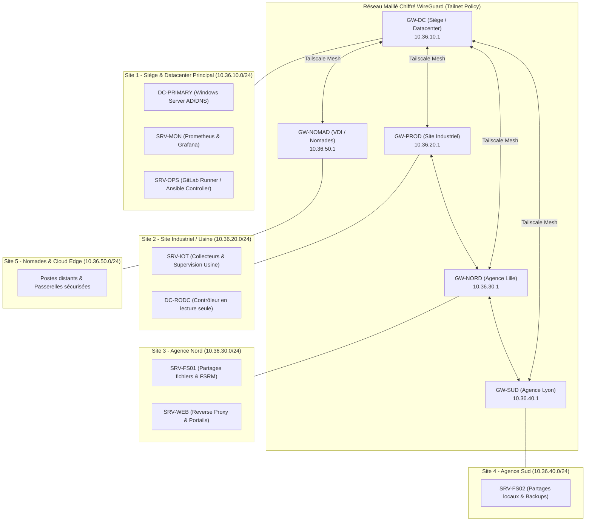
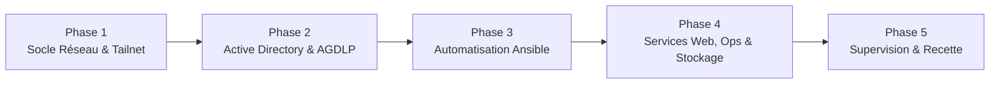

# Nexus360 - Infrastructure & Automatisation Multi-Sites (Promotion B3 - Équipe T01)

[](#topologie-des-5-sites)
[](file:///ansible/)
[](file:///powershell/)
[](file:///reseau/tailnet-policy.hujson)

---

## 1. Présentation du Projet Nexus360

Le projet **Nexus360** a pour objectif de concevoir, déployer, sécuriser et automatiser une infrastructure d'entreprise distribuée sur **5 sites interconnectés**. 

Face aux exigences modernes de résilience, de scalabilité et de conformité aux standards de sécurité, le projet repose sur :
- **Un réseau maillé chiffré (Mesh Overlay)** propulsé par **Tailscale (WireGuard)** complété par un plan d'adressage hiérarchique unifié en `10.36.0.0/16`.
- **Une gestion d'identité et de gouvernance des accès centralisée** via **Active Directory Domain Services (AD DS)** suivant le modèle rigoureux **AGDLP** (Accounts -> Global Groups -> Domain Local Groups -> Permissions) et des quotas de stockage **FSRM**.
- **Une automatisation complète de la configuration système** via **Ansible** pour le déploiement reproductible des socles Linux (serveurs web, services opérationnels, passerelles réseau, stack d'observabilité).
- **Une observabilité de bout en bout** (Prometheus, Grafana, Node Exporter) assurant la supervision proactive des métriques systèmes et des alertes opérationnelles.
- **Une documentation technique vivante** : Dossier d'Architecture Technique ([`DAT.md`](DAT.md)), Journal d'exploitation ([`JOURNAL.md`](JOURNAL.md)), runbooks et fiches d'incidents.

---

## 2. Membres de l'Équipe T01 & Rôles

| Rôle | Responsable | Périmètre d'Intervention |
| :--- | :--- | :--- |
| **Tech Lead & Architecte Réseau** | Équipe T01 | Architecture globale, Tailscale Mesh, plan d'adressage IP `10.36.0.0/16`, passerelles de routage |
| **Ingénieur Systèmes Windows & Sécurité** | Équipe T01 | Active Directory, modèle AGDLP, quotas FSRM, scripts PowerShell de provisionnement |
| **Ingénieur Automatisation & DevOps** | Équipe T01 | Playbooks Ansible, modularité des rôles, durcissement OS Linux (SSH, firewall, services) |
| **Ingénieur Observabilité & Support** | Équipe T01 | Stack de métriques (Prometheus / Grafana), runbooks d'exploitation, gestion des incidents |

---

## 3. Topologie des 5 Sites

L'entreprise Nexus360 est répartie sur 5 environnements interconnectés, chacun disposant de sous-réseaux alloués dans le supernet `10.36.0.0/16` :



### Synthèse des Sites :
1. **Site 1 (Siège / Datacenter - `10.36.10.0/24`)** : Cœur de l'infrastructure, héberge les rôles maîtres AD DS, le monitoring central et les contrôleurs d'automatisation.
2. **Site 2 (Site Industriel / Production - `10.36.20.0/24`)** : Unité de production nécessitant une isolation réseau stricte et un contrôleur de domaine RODC.
3. **Site 3 (Agence Nord - `10.36.30.0/24`)** : Agence régionale avec serveurs applicatifs web et stockage de proximité.
4. **Site 4 (Agence Sud - `10.36.40.0/24`)** : Pôle commercial avec serveur de fichiers décentralisé et réplication de sauvegarde.
5. **Site 5 (Nomades & Cloud Edge - `10.36.50.0/24`)** : Gestion des accès distants sécurisés par politique Tailnet basée sur l'identité (Zero Trust ACLs).

---

## 4. Démarche de Déploiement

Le déploiement suit un cycle rigoureux articulé en 5 phases séquentielles :



1. **Phase 1 : Socle Réseau & Interconnexion**
   - Mise en place du plan d'adressage `10.36.0.0/16`.
   - Déploiement des routeurs de sous-réseaux (*Subnet Routers*) via Tailscale.
   - Application de la politique de sécurité [`reseau/tailnet-policy.hujson`](file:///reseau/tailnet-policy.hujson).
2. **Phase 2 : Socle Active Directory & Gouvernance des Accès**
   - Création de la forêt et du domaine `nexus360.local`.
   - Hiérarchisation des Unités d'Organisation (OU).
   - Déploiement automatisé des utilisateurs et groupes via PowerShell ([`powershell/scripts/`](file:///powershell/scripts/)).
   - Mise en œuvre du modèle AGDLP et des quotas de fichiers FSRM ([`powershell/config/`](file:///powershell/config/)).
3. **Phase 3 : Industrialisation Ansible**
   - Configuration de l'environnement ([`ansible/ansible.cfg`](file:///ansible/ansible.cfg)).
   - Déploiement du rôle `base` pour standardiser les distributions Linux (Debian / Ubuntu / Rocky).
   - Configuration du rôle de passerelle réseau `gw`.
4. **Phase 4 : Services Web, Opérationnels et Stockage**
   - Déploiement des serveurs web via le rôle `web` (Nginx durci, reverse proxy).
   - Automatisation des tâches de maintenance avec le rôle `ops`.
   - Sécurisation des partages et volumes de données.
5. **Phase 5 : Observabilité & Validation Opérationnelle**
   - Déploiement de la stack Prometheus & Grafana avec le rôle `mon`.
   - Validation de la matrice des flux et des tests de bascule.
   - Formalisation des fiches d'incidents et des procédures d'exploitation.

---

## 5. Structure du Dépôt Git

```text
Projet_Nexus360_B3/
├── README.md                      # Présentation globale, topologie et démarche
├── DAT.md                         # Dossier d'Architecture Technique de référence
├── JOURNAL.md                     # Journal de bord et suivi chronologique des séances
├── .gitignore                     # Règles d'exclusion Git (clés, secrets, caches)
│
├── ansible/                       # Orchestration et gestion de configuration
│   ├── ansible.cfg                # Configuration générale d'Ansible
│   ├── site.yml                   # Playbook maître d'orchestration
│   ├── inventory/                 # Inventaires des machines hôtes
│   │   └── hosts.ini
│   └── roles/                     # Rôles Ansible modulaires
│       ├── base/                  # Rôle socle (mises à jour, paquets, SSH, NTP)
│       ├── web/                   # Rôle serveur Web (Nginx, HTTPS, vhosts)
│       ├── ops/                   # Rôle opérationnel (sauvegardes, maintenance)
│       ├── mon/                   # Rôle métriques & supervision (Prometheus/Grafana)
│       └── gw/                    # Rôle passerelle réseau (routage, nftables)
│
├── powershell/                    # Automatisation Active Directory & Windows Server
│   ├── config/                    # Fichiers sources déclaratifs
│   │   ├── users.csv              # Annuaire des utilisateurs à provisionner
│   │   ├── groups.json            # Définition des groupes AGDLP
│   │   └── shares.json            # Configuration des partages et quotas FSRM
│   └── scripts/                   # Scripts PowerShell d'exécution
│       ├── 01_Deploy-ActiveDirectoryBase.ps1
│       ├── 02_Provision-UsersAndAGDLP.ps1
│       ├── 03_Configure-FSRMQuotasAndShares.ps1
│       └── Toolbox-D2.ps1         # Boîte à outils de diagnostics et maintenance
│
├── reseau/                        # Configurations réseau et sécurité
│   └── tailnet-policy.hujson      # Politique ACL Tailscale (Mesh WireGuard Zero Trust)
│
└── docs/                          # Documentation opérationnelle
    ├── runbooks/                  # Guides de procédures techniques
    │   ├── RUNBOOK_DEPLOIEMENT_ANSIBLE.md
    │   ├── RUNBOOK_ACTIVE_DIRECTORY_AGDLP.md
    │   └── RUNBOOK_INTERCONNEXION_TAILNET.md
    └── incidents/                 # Post-mortems et fiches d'incidents
        ├── INCIDENT_TEMPLATE.md
        └── INC-2026-001_RUPTURE_ROUTAGE_INTERSITE.md
```

---

## 6. Prise en Main Rapide

### Prérequis
- Git `>= 2.30`
- Ansible `>= 2.15`
- PowerShell `>= 7.2` (sur contrôleurs Windows)
- Client Tailscale connecté au tailnet du projet

### Déploiement de l'Infrastructure Ansible
```bash
# Se placer dans le dossier Ansible
cd ansible

# Vérifier la connectivité avec l'ensemble des nœuds
ansible -i inventory/hosts.ini all -m ping

# Lancer le déploiement complet
ansible-playbook -i inventory/hosts.ini site.yml
```

### Initialisation Active Directory & AGDLP
```powershell
# Exécuter depuis une console PowerShell en tant qu'administrateur de domaine
cd powershell\scripts
.\01_Deploy-ActiveDirectoryBase.ps1
.\02_Provision-UsersAndAGDLP.ps1
.\03_Configure-FSRMQuotasAndShares.ps1
```
