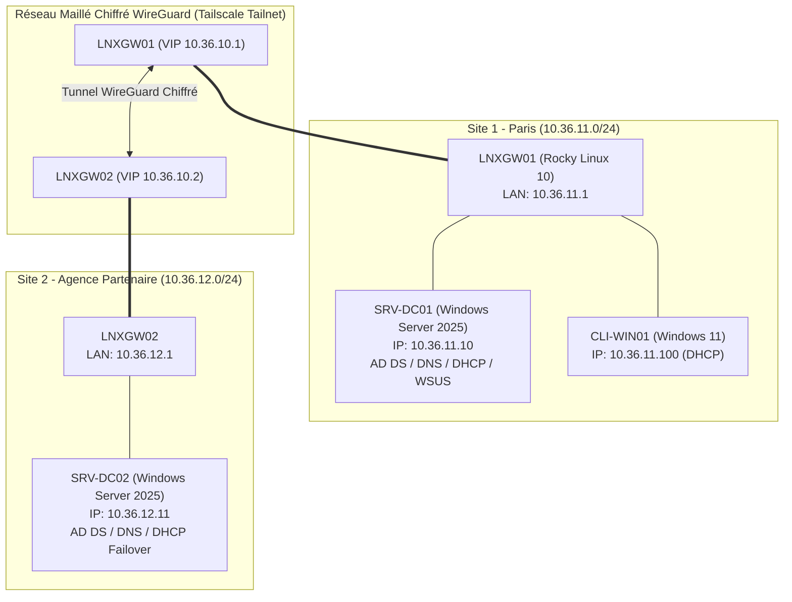
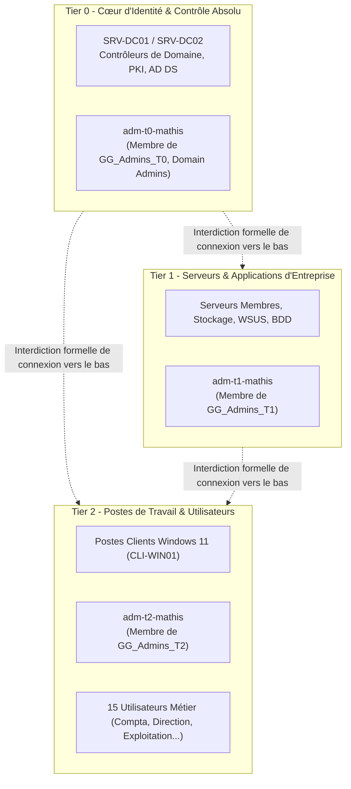

# Dossier d'Architecture Technique (DAT) - Site 1 (Paris)
## Projet Nexus360 - Promotion B3 - Mission T01

---

## 1. Contexte & Périmètre du Site 1

Dans le cadre du projet d'infrastructure globale d'entreprise **Nexus360**, le **Site 1 (Paris)** constitue le site central d'infrastructure et d'identité hébergeant le premier contrôleur de domaine Active Directory, les services DNS/DHCP maîtres, ainsi que la passerelle de routage et d'interconnexion réseau maillé.

Le domaine d'entreprise officiel est : **`ad.nexus360.test`**  
Le supernet global alloué à l'organisation est : **`10.36.0.0/16`**

Le présent document détaille l'architecture système, réseau et sécuritaire du Site 1 et son intégration avec le Site 2.

---

## 2. Plan d'Adressage IP & Topologie Réseau

### 2.1. Sous-réseau du Site 1 (`10.36.11.0/24`)

| Plage IP / Hôte | Rôle / Affectation | Description |
| :--- | :--- | :--- |
| **`10.36.11.1`** | Passerelle locale (`LNXGW01`) | Interface LAN eth1 / Default Gateway |
| **`10.36.11.2 - 10.36.11.9`** | Réservé Équipements Réseau | Switchs de cœur, AP Wi-Fi, sondes |
| **`10.36.11.10`** | Contrôleur de domaine (`SRV-DC01`) | Windows Server 2025 (AD DS, DNS, DHCP, WSUS) |
| **`10.36.11.11 - 10.36.11.49`** | Serveurs d'infrastructure fixes | Serveurs de fichiers, monitoring, proxies locaux |
| **`10.36.11.50 - 10.36.11.99`** | Adresses IP Statiques réservées | Imprimantes réseau, équipements IoT |
| **`10.36.11.100 - 10.36.11.200`**| **Pool DHCP Clients** | Postes de travail utilisateurs (`CLI-WIN01`...) |
| **`10.36.11.201 - 10.36.11.254`**| Réservations temporaires / VIP | VIP HA, pool nomade local |

### 2.2. Interconnexion Multi-Sites & Overlay Tailscale

- **Passerelle `LNXGW01`** :
  - IP LAN Site 1 : `10.36.11.1/24`
  - VIP / IP Tailnet Overlay : `10.36.10.1`
  - Rôle : **Tailscale Subnet Router** annonçant le préfixe `10.36.11.0/24` vers le Tailnet d'entreprise.
- **Site 2 (Site Partenaire)** :
  - Sous-réseau : `10.36.12.0/24`
  - Passerelle : `LNXGW02` (`10.36.12.1` / VIP Tailscale `10.36.10.2`)
  - Second Contrôleur de domaine : `SRV-DC02` (`10.36.12.11`)



---

## 3. Inventaire des Machines du Site 1

### 3.1. Passerelle Réseau - `LNXGW01`
- **Système d'exploitation** : Rocky Linux 10 (Kernel 6.x, RHEL 10-compatible)
- **Interfaces réseau** :
  - `eth0` : Interface WAN (DHCP public / NAT Internet vers l'hyperviseur)
  - `eth1` : Interface LAN Site 1 (`10.36.11.1/24`, sans passerelle sur cette interface)
  - `tailscale0` : Interface virtuelle WireGuard (`10.36.10.1`)
- **Services actifs** :
  - `firewalld` avec masquerading NAT activé sur la zone externe
  - `sysctl` avec `net.ipv4.ip_forward = 1`
  - Démon `tailscaled` configuré en `--advertise-routes=10.36.11.0/24 --snat-subnet-routes=false`

### 3.2. Contrôleur de Domaine Principal - `SRV-DC01`
- **Système d'exploitation** : Windows Server 2025 Datacenter
- **Nom NetBIOS / FQDN** : `SRV-DC01` / `SRV-DC01.ad.nexus360.test`
- **Adresse IP** : `10.36.11.10/24`
- **Passerelle par défaut** : `10.36.11.1`
- **DNS Principal** : `127.0.0.1` (local) puis `10.36.12.11` (SRV-DC02)
- **Rôles installés** :
  - Active Directory Domain Services (AD DS) - Niveau fonctionnel de forêt/domaine Windows Server 2025
  - DNS Server (Zones directe `ad.nexus360.test` et inverse `36.10.in-addr.arpa`)
  - DHCP Server (Scope `10.36.11.0/24`, basculement Failover LoadBalance 50/50 avec `SRV-DC02`)
  - WSUS (Windows Server Update Services - Port TCP 8530)

### 3.3. Client de Test - `CLI-WIN01`
- **Système d'exploitation** : Windows 11 Entreprise (x64)
- **Nom NetBIOS / FQDN** : `CLI-WIN01` / `CLI-WIN01.ad.nexus360.test`
- **Attribution IP** : Dynamique via DHCP (`10.36.11.100` à `10.36.11.200`)
- **Passerelle obtenue** : `10.36.11.1`
- **Serveurs DNS obtenus** : `10.36.11.10`, `10.36.12.11`
- **Adhésion domaine** : Joint au domaine `ad.nexus360.test` dans l'OU `Nexus360/Postes`

---

## 4. Matrice des Flux Réseau & Ports Ouverts

La matrice ci-dessous définit l'ensemble des flux autorisés sur le pare-feu du Site 1 et entre les composants de l'infrastructure :

| Port / Protocole | Service / Rôle | Source | Destination | Justification Métier / Technique |
| :--- | :--- | :--- | :--- | :--- |
| **53 UDP / TCP** | DNS | Clients, Serveurs, GW | `SRV-DC01` (`10.36.11.10`) | Résolution de noms directe et inverse Active Directory |
| **88 UDP / TCP** | Kerberos | Clients, Serveurs | `SRV-DC01` (`10.36.11.10`) | Authentification des utilisateurs et des machines AD DS |
| **135 TCP** | RPC Endpoint Mapper | Clients, Serveurs, DC2 | `SRV-DC01` (`10.36.11.10`) | Localisation des endpoints RPC pour DCOM, FRS, WMI |
| **389 UDP / TCP** | LDAP | Clients, Serveurs, DC2 | `SRV-DC01` (`10.36.11.10`) | Requêtes d'annuaire et localisation des services de domaine |
| **445 TCP** | SMB / CIFS | Clients, Serveurs, DC2 | `SRV-DC01` (`10.36.11.10`) | Accès aux partages SYSVOL / Netlogon, propagation des GPO |
| **8530 TCP** | WSUS HTTP | Clients (`CLI-WIN01`) | `SRV-DC01` (`10.36.11.10`) | Téléchargement et synchronisation des mises à jour Windows |
| **67 / 68 UDP** | DHCP (Bootps / Bootpc) | Clients (`CLI-WIN01`) | `SRV-DC01` (`10.36.11.10`) | Négociation DORA d'adresses IP pour les postes de travail |
| **647 TCP** | DHCP Failover | `SRV-DC02` (`10.36.12.11`) | `SRV-DC01` (`10.36.11.10`) | Synchronisation de la table des baux DHCP entre les deux DC |
| **41641 UDP** | Tailscale WireGuard | `LNXGW01` | Internet / Noeuds Tailnet | Établissement des tunnels chiffrés point-à-point du maillage |
| **ICMP** | Ping (Echo Request/Reply)| Tout sous-réseau | Tout sous-réseau | Diagnostic et vérification de la joignabilité réseau |

---

## 5. Modèle d'Administration Tiering (T0 / T1 / T2)

Pour immuniser l'infrastructure contre les attaques par rebond (Pass-the-Hash, Golden Ticket, compromission latérale), Nexus360 implémente l'architecture de sécurité **Microsoft Active Directory Tiering Model** (recommandation ANSSI / CIS).



### 5.1. Définition des Tiers

1. **Tier 0 (Identité & Infrastructure Critique)** :
   - Périmètre : Contrôleurs de domaine (`SRV-DC01`, `SRV-DC02`), PKI, Azure AD Connect, comptes `Domain Admins`.
   - Compte dédié : **`adm-t0-mathis`** (placé dans `OU=T0-Admins,OU=Administration,OU=Nexus360,...`).
   - Règle d'or : Ce compte **ne doit jamais** ouvrir de session interactive ou RDP sur un serveur T1 ou un poste de travail T2.
2. **Tier 1 (Serveurs Membres & Services)** :
   - Périmètre : Serveurs applicatifs, serveurs de fichiers FSRM, serveurs de bases de données, WSUS.
   - Compte dédié : **`adm-t1-mathis`** (placé dans `OU=T1-Admins,OU=Administration,OU=Nexus360,...`).
   - Règle d'or : Administration exclusive des serveurs membres. Aucune ouverture de session autorisée sur les postes clients.
3. **Tier 2 (Postes de Travail & Support Utilisateur)** :
   - Périmètre : Postes clients Windows 11 (`CLI-WIN01`), imprimantes, sessions utilisateurs.
   - Compte dédié : **`adm-t2-mathis`** (placé dans `OU=T2-Admins,OU=Administration,OU=Nexus360,...`).
   - Règle d'or : Ce compte possède des privilèges administrateur local sur les postes de travail uniquement, et ne possède aucun accès administratif sur les serveurs ou les DC.

### 5.2. Mesures Techniques & GPO de Restriction

L'application du cloisonnement est garantie par la stratégie de groupe **`GPO_Security_Block_T0_Logon`** :
- **Attribution des droits d'utilisateurs** :
  - *Interdire l'ouverture de session locale* (`SeDenyInteractiveLogonRight`) : appliqué au groupe `GG_Admins_T0`.
  - *Interdire l'ouverture de session par les services Bureau à distance* (`SeDenyRemoteInteractiveLogonRight`) : appliqué au groupe `GG_Admins_T0`.
- **Liaison de la GPO** :
  - Liée avec option *Enforced* sur l'OU `Nexus360/Postes`.
  - Liée avec option *Enforced* sur l'OU `Nexus360/Services/Serveurs-T1`.
- **Résultat** : Même si le mot de passe du compte `adm-t0-mathis` est connu, toute tentative d'ouverture de session sur une machine T1 ou T2 est immédiatement rejetée au niveau du sous-système de sécurité local (LSA). Aucun hash de mot de passe T0 ne réside en mémoire LSASS sur les machines clientes.

---

## 6. Structure Active Directory & Modèle AGDLP

### 6.1. Arborescence des Unités Organisationnelles (OU)
```
ad.nexus360.test (Domaine racine)
└── Nexus360
    ├── Administration
    │   ├── T0-Admins       --> Comptes adm-t0-*
    │   ├── T1-Admins       --> Comptes adm-t1-*
    │   └── T2-Admins       --> Comptes adm-t2-*
    ├── Services
    │   └── Serveurs-T1     --> Serveurs applicatifs & stockage
    ├── Postes              --> Postes clients Windows 11 (CLI-WIN01)
    ├── Utilisateurs        --> 15 utilisateurs métier
    └── Groupes             --> Groupes de sécurité AGDLP
```

### 6.2. Implémentation AGDLP
- **A (Accounts)** : Utilisateurs créés dans `OU=Utilisateurs` (ex : `cdubois`, `slaurent`, `lbernard`, `mfontaine`).
- **G (Global Groups)** : Groupes métier reflétant l'organisation :
  - `GG_Direction`
  - `GG_Comptabilite`
  - `GG_Exploitation`
  - `GG_Informatique`
- **DL (Domain Local Groups)** : Groupes de permissions sur les ressources :
  - `DL_Direction_Share_RW`
  - `DL_Compta_Share_RW`
  - `DL_Exploitation_Share_RW`
  - `DL_Informatique_Share_RW`
- **P (Permissions)** : Droits NTFS / SMB assignés aux groupes `DL_*` exclusivement.
